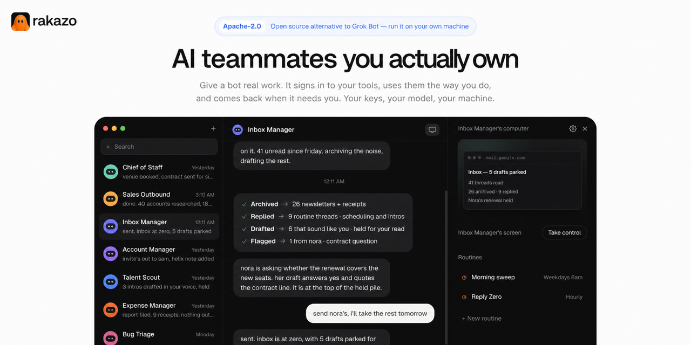

# Rakazo

[](https://github.com/elie222/rakazo/stargazers)
[](https://discord.gg/RWwKa2Sn7h)
[](https://apps.apple.com/app/rakazo/id6801531099)
[](https://github.com/elie222/rakazo/releases/download/android/rakazo.apk)



Rakazo is an open source AI agent for persistent teammates, and a self-hosted AI assistant you
can run on your own machine. It is available on the web, as an Electron desktop app, and on
[iPhone](https://apps.apple.com/app/rakazo/id6801531099) and [Android](https://github.com/elie222/rakazo/releases/download/android/rakazo.apk). Bring your own model
and computer provider, or run the complete stack locally.

It is an open source, self-hosted alternative to Grok Bot, Meta Muse, OpenAI Dots, Instinct,
OpenClaw, Hermes Agent, and Hark Pro.

Rakazo is in beta. Learn more at [rakazo.com](https://rakazo.com).

## Fork personale / Personal fork

**IT —** Questo repository è un fork di [elie222/rakazo](https://github.com/elie222/rakazo) (Apache-2.0, attribuzione e `LICENSE` originali invariati) con le modifiche che uso sulla mia istanza self-hosted e sulla mia app Android personale. Nessun segreto è incluso: niente `.env`, chiavi, token o keystore — fornisci i tuoi.

**EN —** This repository is a fork of [elie222/rakazo](https://github.com/elie222/rakazo) (Apache-2.0; upstream attribution and `LICENSE` unchanged) carrying the changes I run on my self-hosted instance and my personal Android app. No secrets are included: no `.env`, keys, tokens or keystores — bring your own.

### Branch / Branches

| Branch | Base | IT | EN |
|---|---|---|---|
| `main` | upstream `main` | Copia di upstream senza modifiche. | Untouched mirror of upstream. |
| [`selfhost-v2`](https://github.com/Njcki/rakazo/tree/selfhost-v2) | upstream `0723154` | Patch web/server per il self-host (21 commit, uno per patch) + `patches-v2/` per l'immagine Docker. | Web/server self-host patches (21 commits, one per patch) + `patches-v2/` to build the Docker image. |
| [`android-app`](https://github.com/Njcki/rakazo/tree/android-app) | upstream `main` | App Android personale in `apps/mobile` (package `com.rakazo.fork`). | Personal Android app in `apps/mobile` (package `com.rakazo.fork`). |

L'app Android vive nello stesso monorepo, non in un repo separato. / *The Android app lives in the same monorepo, not in a separate repo.*

### Modifiche in questo branch (`selfhost-v2`) / Changes in this branch

| # | IT | EN |
|---|---|---|
| 0001 | **Alias modelli locali**: alias extra con etichetta, context e max token propri da `/data/local-extra-models.json` o `RAKAZO_LOCAL_EXTRA_MODELS`; l'id viene riscritto a `upstreamId` verso il server. | **Local model aliases**: extra aliases with their own label, context and max tokens from `/data/local-extra-models.json` or `RAKAZO_LOCAL_EXTRA_MODELS`; the id is rewritten to `upstreamId` on the wire. |
| 0002, 0010 | **Allegati di qualsiasi tipo fino a 100 MiB**, fallback `application/octet-stream`; se il browser manda octet-stream vince l'estensione nota. | **Attachments of any type up to 100 MiB** with an `application/octet-stream` fallback; a known extension wins over octet-stream. |
| 0003 | **TTS nella lingua della UI**: la lingua dell'interfaccia viene passata a ElevenLabs come `language_code`. | **TTS in the UI language**: the UI locale is passed to ElevenLabs as `language_code`. |
| 0004, 0008, 0009 | **Interfaccia web in italiano**: locale `it` registrato, catalogo completo (1107/1107), loader nei test. | **Italian web UI**: `it` locale registered, full catalog (1107/1107), test loaders. |
| 0005 | **Compattazione**: timeout fisso di 480 s per il riassunto. | **Compaction**: fixed 480 s summarizer timeout. |
| 0006 | **Path del computer**: i path assoluti `/home/rakazo/...` vengono risolti nel workspace. | **Computer paths**: absolute `/home/rakazo/...` paths resolve inside the workspace. |
| 0007 | **Pulsante «Continua»**: risponde a una domanda in sospeso o riprende un turno lasciato a metà. | **"Continue" button**: answers a pending question or resumes an unfinished turn. |
| 0011 | Formattazione biome dei file toccati. | Biome formatting of touched files. |
| 0012 | **Narrazione a metà turno** fino a 8000 caratteri (i messaggi di progresso restano a 500). | **Mid-turn narration** up to 8000 characters (progress beats stay at 500). |
| 0013, 0014, 0017 | **Piano**: scomposizione dei task con strumenti `plan_*`, tabelle DB, pannello «Piano» di primo livello, piani completati visibili finché non ne nasce uno nuovo. | **Plan**: task decomposition with `plan_*` tools, DB tables, a top-level "Plan" panel, completed plans stay visible until replaced. |
| 0015, 0016 | **Impostazioni bot**: «Salva» sempre visibile, divisori tra sezioni, card di Avanzate a filo. | **Bot settings**: always-visible Save, section dividers, flush Advanced cards. |
| 0018 | Card più scure, campi a riposo bianchi, placeholder più chiari. | Darker cards, white idle fields, lighter placeholders. |
| 0019, 0020 | Icone sui titoli delle sezioni e delle card di Avanzate. | Icons on section and Advanced card titles. |
| 0021 | **Formule matematiche**: `$…$`, `$$…$$`, `\(…\)`, `\[…\]` composte con KaTeX (remark-math + rehype-katex); i prezzi tipo «$5 o $10» restano testo. | **Math formulas**: `$…$`, `$$…$$`, `\(…\)`, `\[…\]` typeset with KaTeX (remark-math + rehype-katex); prices like "$5 or $10" stay text. |
| 0022 | **Ricerca web con SearXNG**: `web_search` usa un'istanza SearXNG self-hosted (API JSON) se è impostato `SEARXNG_URL` (o `WEB_PROVIDER=searxng`), con ripiego su DuckDuckGo se SearXNG va in errore, scade o non trova nulla; `web_fetch` invariato. | **Web search via SearXNG**: `web_search` uses a self-hosted SearXNG instance (JSON API) when `SEARXNG_URL` is set (or `WEB_PROVIDER=searxng`), falling back to DuckDuckGo when SearXNG errors, times out or finds nothing; `web_fetch` unchanged. |
| 0023 | **Tavily come riserva**: con `TAVILY_API_KEY` la ricerca segue SearXNG → Tavily → DuckDuckGo; Tavily (profondità basic, 1 credito) solo se SearXNG fallisce, scade o non trova nulla, e ogni chiamata viene registrata nel log. | **Tavily as backup**: with `TAVILY_API_KEY` search goes SearXNG → Tavily → DuckDuckGo; Tavily (basic depth, 1 credit) only when SearXNG fails, times out or finds nothing, and every call is logged. |
| 0024 | **Exa e Serper come riserve successive**: la ricerca segue SearXNG → Tavily → Exa → Serper → DuckDuckGo; ogni servizio a pagamento si usa solo con la sua chiave e solo se tutti i precedenti falliscono o non trovano nulla; ogni chiamata viene registrata nel log (Exa anche col costo). | **Exa and Serper as further backups**: search goes SearXNG → Tavily → Exa → Serper → DuckDuckGo; each paid service is used only with its key and only when every earlier one fails or finds nothing; every call is logged (Exa with its cost). |
| 0025 | **La chat resta in fondo**: se sei in fondo (o quasi) le nuove risposte, il testo in streaming e le immagini/grafici/formule che si caricano dopo restano visibili; un clic o tap non ferma più lo scorrimento automatico; se sei salito a leggere la vista non si sposta e il pulsante per tornare in fondo mostra un pallino «nuovi messaggi». | **Chat sticks to the bottom**: when you are at (or near) the bottom, new replies, streaming text and late-loading images/charts/math stay in view; a click or tap no longer stops auto-scroll; if you scrolled up to read, the view stays put and the jump-to-bottom button shows a "new messages" dot. |
| 0026 | **Niente risposte finali tronche**: se dopo una serie di strumenti il bot chiude con una frase che annuncia soltanto il passo successivo («Leggiamo la sezione 8…») o con una chiamata a strumento scritta come testo, riceve un sollecito automatico (al massimo 2 per risposta): continua davvero oppure scrive il riepilogo finale (cosa ha fatto, cosa ha trovato, cosa resta, «continua» per proseguire). Raggiunto il limite di chiamate agli strumenti, una chiamata finale senza strumenti scrive lo stesso riepilogo invece del solo avviso. | **No dangling final replies**: when a tool run ends with a sentence that only announces the next step ("Let me read section 8…") or with a tool call written as text, the bot gets one automatic nudge (at most 2 per reply): keep going for real or write the final summary (what was done, what was found, what remains, "continua" to go on). When the tool-call limit is reached, a final no-tools call writes the same summary instead of only the stop notice. |
| 0027 | **Un messaggio mentre il bot lavora non lo ferma**: se scrivi durante un lavoro in corso (per esempio «fammi un riassunto di dove sei»), il bot risponde in breve nella tua lingua e poi riprende il compito; si ferma o cambia strada solo se glielo chiedi esplicitamente. Se risponde solo con testo, riceve un sollecito automatico a continuare (stesso limite della 0026). | **A message while the bot works no longer stops it**: if you write during a running task (e.g. "give me a summary of where you are"), the bot answers briefly in your language and then resumes the task; it stops or changes course only if you explicitly ask. If it replies with text only, it gets an automatic nudge to continue (same cap as 0026). |

Commit upstream fissato / pinned upstream commit: `0723154f23d6622ef0f4accafdd170e1cda808dd` (`patches-v2/PINS`). Dettagli: `patches-v2/CHANGELOG.md`.

### Uso / Usage

**Requisiti / Requirements:** Node 22+, pnpm (`corepack enable`), Docker + Docker Compose; un tuo `.env` come da upstream (es. `SANDBOX_SUPERVISOR_TOKEN`). / *your own `.env` as in upstream.*

```bash
git checkout selfhost-v2
pnpm install
pnpm --filter @rakazo/web build          # sviluppo/dev: vedi la guida upstream sotto
# Immagine Docker sopra l'immagine upstream fissata / Docker image on top of the pinned upstream image:
cd patches-v2
docker build --build-arg BASE=ghcr.io/elie222/rakazo/app@$(. ./PINS; echo $APP_DIGEST) -t rakazo-app-nk .
```

**IT —** `patches-v2/update-rakazo-v2.sh` è lo script che uso sul mio server (adatta i percorsi). Le tabelle del Piano vengono create dalla normale migrazione di Rakazo. `patches-v2/compose/` contiene una patch opzionale (timeout comandi 20 min, `SANDBOX_IDLE_MS`).
**EN —** `patches-v2/update-rakazo-v2.sh` is the script I use on my server (adjust paths). Plan tables are created by Rakazo's normal migration. `patches-v2/compose/` holds an optional patch (20 min command timeout, `SANDBOX_IDLE_MS`).

Vedi anche / see also [FORK.md](FORK.md).

---

### PC dei bot / Bots' computer image (`computer-tools/`)

**IT** — `computer-tools/` contiene Dockerfile e script `page-text` per costruire localmente un'immagine computer estesa (OCR tesseract eng/fra/ita, poppler, djvulibre, git, jq, ripgrep…), partendo dal digest upstream fissato in `patches-v2/PINS`. Non è un'immagine binaria: `docker build --build-arg BASE_IMAGE=ghcr.io/elie222/rakazo/computer@sha256:<COMPUTER_DIGEST> -t rakazo-computer-tools:local computer-tools`, poi nel `.env` `RAKAZO_COMPUTER_IMAGE=rakazo-computer-tools` e `RAKAZO_COMPUTER_IMAGE_TAG=local`.

**EN** — `computer-tools/` holds the Dockerfile and `page-text` script to build an extended bots' computer image locally (OCR, PDF/DjVu tools, dev CLIs) from the upstream digest pinned in `patches-v2/PINS`. Build with the command above and set `RAKAZO_COMPUTER_IMAGE` / `RAKAZO_COMPUTER_IMAGE_TAG` in `.env`. See `computer-tools/README.md`.

## How Rakazo compares

Once Rakazo is running, it is just chat, like Grok Bot: you set up a bot and manage it from that
chat. Muse, Dots, Instinct, and Hark Pro are hosted assistants. OpenClaw
and Hermes Agent are also open source agents you can run yourself. Their docs describe installers,
config files, and a gateway. Hermes Desktop can reach a first chat without the CLI; a messaging
gateway is a separate process.

- [Grok Bot](https://rakazo.com/grok-bot-alternative/)
- [Muse](https://rakazo.com/muse-alternative/)
- [Dots](https://rakazo.com/dots-alternative/)
- [Instinct](https://rakazo.com/instinct-alternative/), the personal assistant you text or call
- [OpenClaw](https://rakazo.com/openclaw-alternative/)
- [Hermes Agent](https://rakazo.com/hermes-alternative/), Nous Research's open source agent
- [Hark Pro](https://rakazo.com/hark-alternative/), the personal agent at hark.com
- [All comparisons](https://rakazo.com/alternatives/)
- [Self-hosting guide](https://rakazo.com/self-hosted-ai-agent/)

## Features

- Persistent bots with their own conversations, memory, routines, and history
- Voice mode: speak replies, dictate, and call a bot. Bring your own ElevenLabs, OpenAI, Cartesia, or Fish Audio key
- Shared Team Computers and isolated Private computers
- Browser, terminal, file, and graphical desktop access
- Bots that can delegate to peer bots or short-lived subagents
- Bring-your-own model credentials through Pi
- App integrations through Composio or Pipedream Connect, plus user-installed Treg, remote MCP, and OpenAPI tool sources
- Docker, E2B, Daytona, CreateOS, Box, and trusted local-computer support

## Demo

https://github.com/user-attachments/assets/dccdeddb-2134-4a56-8eed-b2e591736b1c

## Stack

- TypeScript
- React 19, Vite, and Tailwind CSS
- Electron and Expo
- Hono and oRPC
- PostgreSQL and Prisma
- Better Auth
- Graphile Worker
- Pi
- Docker, E2B, Daytona, CreateOS, and Box
- Composio, Pipedream Connect, MCP, and OpenAPI integrations

## Quick start (published images)

You need Docker Engine, the Compose plugin, curl, and OpenSSL. No clone or Node install.

```bash
mkdir -p rakazo && cd rakazo &&
curl -fsSLO https://raw.githubusercontent.com/elie222/rakazo/main/infra/compose/install-images.sh &&
bash install-images.sh
```

The installer downloads the Compose files, creates `.env` with random secrets, and starts Rakazo.
It preserves an existing `.env` when rerun.

Open [http://127.0.0.1:5173](http://127.0.0.1:5173), create an account, and connect a model.
Local Docker computers are on by default. Optional remote providers: `e2b`, `daytona`, `createos`, or `box`
with the matching API key.

Default image tag is `edge` (main builds, `linux/amd64` + `linux/arm64`). Details and tags:
[self-hosting guide](./docs/self-host.md#published-images-no-checkout).

On restricted networks, override the installer download base (`RAKAZO_DOWNLOAD_BASE`), skip
existing Compose files (`--local` / `RAKAZO_DOWNLOAD_SKIP_EXISTING`), or mirror the bootstrap
script URL — see
[Restricted networks / mirror downloads](./docs/self-host.md#restricted-networks--mirror-downloads).

For an agent-assisted install, use [SETUP_PROMPT.md](./SETUP_PROMPT.md).

## Run on a server

Bots stay on when the backend runs on a server. Use the same installer on a VPS, then connect from
the desktop app, the mobile app, or a browser.

```bash
bash install-images.sh --prepare-only
# edit .env: SANDBOX_PROVIDER=box (or e2b / daytona / createos) with its API key, RAKAZO_HOST=your.domain
bash install-images.sh
```

Put HTTPS in front of port 5173; [docs/self-host.md](./docs/self-host.md#public-single-vm-deployment)
covers the Caddy setup and host hardening. In the desktop app choose **Existing instance** and enter
the `https://` address.

## Local development (source checkout)

You need Node.js 22.22.2 or newer in the 22.x line, Node.js 24.x, or Node.js 26+;
pnpm 9; and Docker. Node.js 23.x and 25.x are not supported.

```bash
git clone https://github.com/elie222/rakazo.git
cd rakazo
cp .env.example .env
```

Set `POSTGRES_PASSWORD` (for example `openssl rand -hex 16`), then put the same value in
`DATABASE_URL`. Set `BETTER_AUTH_SECRET`, `ENCRYPTION_KEY`, and `SCREEN_PROXY_SECRET` to
independent long random values. Docker sandboxes also need a dedicated
`SANDBOX_SUPERVISOR_TOKEN`. You can also set `OPENROUTER_API_KEY`, or connect a supported
model provider during onboarding.

For host-side development with Docker Desktop, set `SANDBOX_CONTROL_VIA_LOOPBACK=true`
in `.env`. The supervisor discovers Docker Desktop's user socket automatically;
`DOCKER_HOST` or `DOCKER_SOCKET` can override it for another Docker runtime.

Managed app catalogs are optional. Set `COMPOSIO_API_KEY` for Composio, or the
`PIPEDREAM_CLIENT_ID`, `PIPEDREAM_CLIENT_SECRET`, and `PIPEDREAM_PROJECT_ID` trio for Pipedream
Connect. Users can add an HTTPS MCP server, Treg endpoint, or OpenAPI JSON document from
**Integrations** without enabling either managed catalog. Connector credentials are encrypted on the
server and are never returned by the API.

Treg is usage-metered. Self-hosters supply their own Treg token; operators embedding Treg in a
hosted product should review [Treg's integration terms](https://treg.to/integrate.md), which require
a written agreement for hosted resale.

```bash
docker compose --env-file .env \
  -f infra/compose/docker-compose.yml \
  -f infra/compose/docker-compose.postgres-host.yml \
  up postgres -d
pnpm install
pnpm db:generate
pnpm db:migrate
pnpm sandbox:build
pnpm dev
```

Postgres stays network-internal in the default Compose file (same as published images). The
`postgres-host` overlay publishes loopback `127.0.0.1:5433` for host-side `pnpm` and DB tools.
If that port is occupied, change `POSTGRES_HOST_PORT` and the port in `DATABASE_URL` in `.env`.
Without the overlay, open a shell with
`docker compose --env-file .env -f infra/compose/docker-compose.yml exec postgres sh -c 'psql -U "$POSTGRES_USER" -d "$POSTGRES_DB"'`.
Use a URI-safe `POSTGRES_PASSWORD` (`openssl rand -hex 16`). An existing `pgdata` volume keeps the
user, password, and database from first init, so keep those values in `.env`, or change them in
place with `ALTER ROLE` / rename. Recreate the volume only after a backup (or when the data is
disposable); `docker compose down -v` deletes all Postgres state.

Open [http://127.0.0.1:5173](http://127.0.0.1:5173), create an account, connect a model, and create
your first bot.

For deployment, provider selection, backups, and upgrades, see the
[self-hosting guide](./docs/self-host.md).

To use CreateOS, set `SANDBOX_PROVIDER=createos` and `CREATEOS_SANDBOX_API_KEY`.
Optional `CREATEOS_SANDBOX_BASE_URL`, `CREATEOS_SANDBOX_SHAPE`, and
`CREATEOS_SANDBOX_ROOTFS` default to `https://api.sb.createos.sh`, `s-2vcpu-2gb`,
and `desktop:1`.

## Desktop and mobile

The Electron and Expo apps are clients of the same Rakazo API used by the web app.

With the development stack running, launch Electron with:

```bash
pnpm --filter @rakazo/desktop dev
```

On first run the desktop app asks whether to run Rakazo on this computer or connect to an existing
server. **This computer** installs and starts the published images with Docker Compose (the same
files as `infra/compose/install-images.sh`) under the app's data directory, so Docker Desktop,
OrbStack, or Docker Engine must be installed; the app links to them when it is not. Installed
builds pin the image tag to their own version; unpackaged builds pull `edge`. Developers running
`pnpm dev` should pick **Existing instance** with `http://127.0.0.1:5173` instead. Public servers
must use HTTPS; HTTP is accepted only for loopback and private LAN addresses (not link-local). The
app verifies Rakazo's health endpoint before saving, and later launches go straight to that
instance. The stack keeps running after the app quits; **Stop Local Stack** in the application
menu turns it off.

Use **Change Rakazo Server…** in the application menu to reconnect. Closing that window without
saving returns to the previous instance. For development automation, set `RAKAZO_WEB_URL` to point
the shell somewhere else without changing the saved instance, or `RAKAZO_FORCE_SETUP=1` to run
setup again.

Mobile build and release instructions live in [docs/mobile-release.md](./docs/mobile-release.md).

## UI language

The web (and Electron-hosted) UI supports English, Deutsch, 한국어, Türkçe, हिन्दी,
Português (Brasil), 简体中文, Español, and Русский under **Settings → Language**. The Expo
app ships English, 简体中文, Русский, and Deutsch catalogs; **Account → Language** offers
English and 简体中文, and the other catalogs follow the device language or
`EXPO_PUBLIC_DEFAULT_UI_LOCALE`. The marketing
homepage (`apps/www`) is available in en/de/ko/zh via footer language links (`/`, `/de/`,
`/ko/`, `/zh/`); other marketing pages stay English. The Russian marketing homepage and
native Electron setup/menu remain separate follow-up work.

## Development

```text
apps/       web, api, worker, desktop, mobile, and public website
packages/   domain, contracts, persistence, adapters, UI, and test tooling
infra/      local services and computer images
docs/       architecture, operations, and release guides
```

Common checks:

```bash
pnpm lint
pnpm check
pnpm test
pnpm test:integration
pnpm test:e2e
```

See [CONTRIBUTING.md](./CONTRIBUTING.md) for the development workflow and test matrix.

## Documentation

- [Self-hosting](./docs/self-host.md)
- [Self-host secrets](./docs/self-host-secrets.md)
- [Computer runtime and isolation](./docs/computer-runtime.md)
- [Desktop releases](./docs/desktop-release.md)
- [Mobile releases](./docs/mobile-release.md)
- [Performance testing](./docs/performance.md)

## Contributing

Contributions are welcome. Please read [CONTRIBUTING.md](./CONTRIBUTING.md) before opening a pull
request. For security vulnerabilities, follow [SECURITY.md](./SECURITY.md) instead of filing a public
issue.

Rakazo is licensed under the [Apache License 2.0](./LICENSE).

Questions and ideas are welcome in the [Rakazo Discord community](https://discord.gg/RWwKa2Sn7h).
